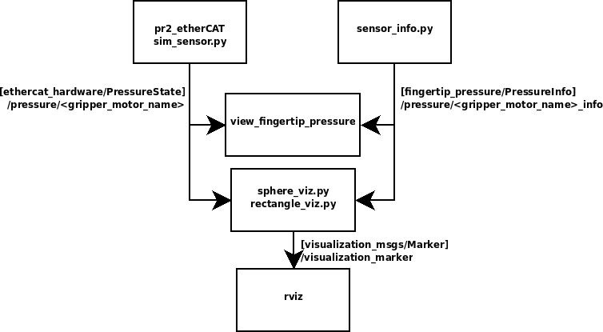
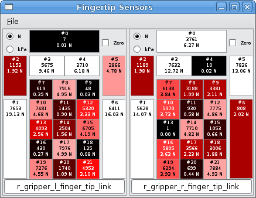

Each pr2 gripper is equipped with two pressure-sensitive fingertips.
Each pressure comprises 22 pressure sensing elements: one on the back, 6
around the edges and a 3x5 array on the front. `fingertip_pressure`
provides nodes to facilitate the visualization and interpretation of the
fingertip pressure sensor data.

## Stability

This package has not been reviewed so the API documented below should be
considered unstable. Also, this package has not been user-tested, so
there may be usability issues with the nodes.

## ROS API

Overview of how the nodes interact with the robot sensor stream:
[](doc/overview.gif)

**Note**: All nodes assume that `<gripper_motor_name>` is either
`r_gripper_motor` or `l_gripper_motor`.

### sensor_info

Publishes sensor geometry, tf frame and unit scaling information.

#### Published Topics

- `/pressure/<gripper_motor_name>_info`
  ([fingertip_pressure/msg/PressureInfo](https://docs.ros.org/en/rolling/p/fingertip_pressure/msg/PressureInfo.html)):
  For each sensor, the tf frame is specified, and for each pressure
  sensing element, a scaling factor to Newtons, and rectangular geometry
  approximation are provided.

### view_fingertip_pressure

RX visualization panel to show the fingertip pressure information.
Allows conversion to N or kPa units and zero-offset removal.

#### Subscribed Topics

- `board`
  ([pr2_msgs/msg/PressureState](https://docs.ros.org/en/rolling/p/pr2_msgs/msg/PressureState.html)):
  Raw data from the pressure sensor. If board is not remapped, it will
  be automatically remapped to pressure/r_gripper_motor. (For versions
  prior to and including 1.0.3, the source was always
  pressure/r_gripper_motor.)
- `<board>_info`
  ([fingertip_pressure/msg/PressureInfo](https://docs.ros.org/en/rolling/p/fingertip_pressure/msg/PressureInfo.html)):
  Sensor calibration, geometry and tf frame.

Example of `view_fingertip_pressure` GUI:

[](doc/fingertip_sensors_panel.png)

### sphere_viz

Provide visualization markers of the fingertip pressure data.

#### Subscribed Topics

- `/pressure/<gripper_motor_name>`
  ([pr2_msgs/msg/PressureState](https://docs.ros.org/en/rolling/p/pr2_msgs/msg/PressureState.html)):
  Raw data from the pressure sensor
- `/pressure/<gripper_motor_name>_info`
  ([fingertip_pressure/msg/PressureInfo](https://docs.ros.org/en/rolling/p/fingertip_pressure/msg/PressureInfo.html)):
  Sensor calibration, geometry and tf frame.

#### Published Topics

- `"/visualization_marker"`
  ([visualization_msgs/msg/Marker](https://docs.ros.org/en/rolling/p/visualization_msgs/msg/Marker.html)):
  Graphical objects to be displayed.

### rectangle_viz

Provide visualization markers of the fingertip pressure data. A more
limited form of `sphere_viz` that allows the geometry of the sensor
output to be checked.

#### Subscribed Topics

- `/pressure/<gripper_motor_name>`
  ([pr2_msgs/msg/PressureState](https://docs.ros.org/en/rolling/p/pr2_msgs/msg/PressureState.html)):
  Raw data from the pressure sensor
- `/pressure/<gripper_motor_name>_info`
  ([fingertip_pressure/msg/PressureInfo](https://docs.ros.org/en/rolling/p/fingertip_pressure/msg/PressureInfo.html)):
  Sensor calibration, geometry and tf frame.

#### Published Topics

- `"/visualization_marker"`
  ([visualization_msgs/msg/Marker](https://docs.ros.org/en/rolling/p/visualization_msgs/msg/Marker.html)):
  Graphical objects to be displayed.

### sim_sensor

Allows the fingertip_pressure package to be tested without actual
hardware by providing a raw sensor data feed.

#### Published Topics

- `/pressure/<gripper_motor_name>`
  ([pr2_msgs/msg/PressureState](https://docs.ros.org/en/rolling/p/pr2_msgs/msg/PressureState.html)):
  Simulated pressure sensor data.

### Launch files

`launch/fingertip_demo.launch` is a standalone demo of the package's
capabilities. It runs all the package's nodes, and rviz (to view the
visualization markers). This should demonstrate all the packages
capabilities.

Example: 

```
$ roslaunch launch/fingertip_demo.launch
```

 and in a separate shell:


```
$ roscd pr2_gazebo
$ roslaunch pr2_empty.launch
```

## Troubleshooting

### Errors when using fingertip_pressure

#### No Data From Sensors

Use [rostopic](https://index.ros.org/p/rostopic) to check if the sensors
are properly publishing data.


```
rostopic echo pressure/r_gripper_motor
```


If the data for pressure contains only "0" or "-1" values, then the
tip sensors are not properly hooked up. You'll need to check your
connections.

#### No Data Displayed By Visual Tools

The visual tools in this package always look for messages on the *right*
gripper motor. If you are looking for data from the left gripper, you
will have to remap the topics.

You can check if the topic is properly remapped by running
"[rosnode](https://index.ros.org/p/rosnode) info" on the viewer, or
"[rostopic](https://index.ros.org/p/rostopic) info" on the topic.
